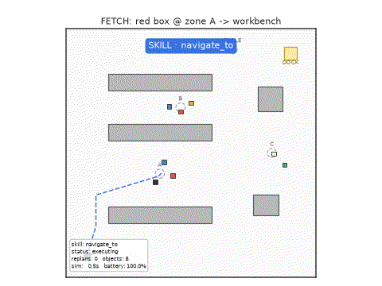
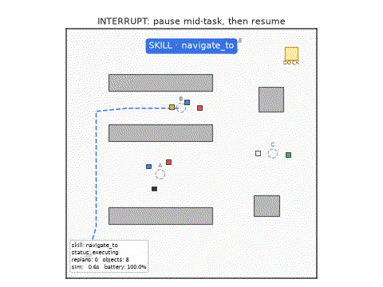
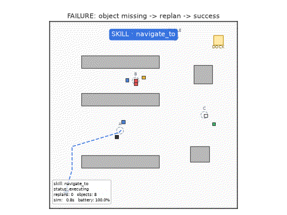
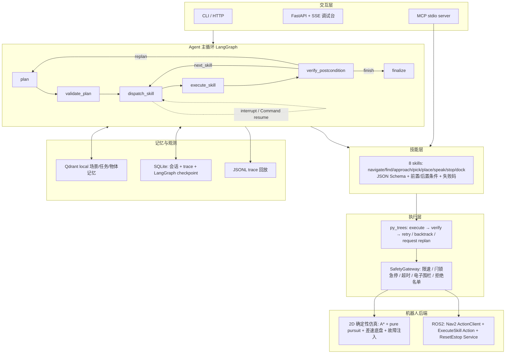

# Embodied AgentOS

**一句话定位**：一个把「自然语言长程指令 → 任务图 Plan-and-Act → 8 类机器人技能 → 行为树执行 → 安全网关 → 2D 确定性仿真 → 后置条件校验 → 失败重规划」完整跑通的具身 Agent 运行时；
所有评测数字都在本机实测、可复现，ROS2 适配层与 ament 包提供完整代码但**未在本机（Windows，无 ROS2）运行过**。

> 个人项目 · 2026.06 – 2026.10 · 作者：陈彦希 · MIT License

---

## 1. 这个项目解决什么问题

机器人已经有导航、抓取等原子能力，但缺一个「把自然语言任务变成技能序列、执行中失败能重规划、并且保证安全」的运行时。本项目在纯 Python 2D 仓储仿真中实现四层 AgentOS：

```
交互/指令层  →  Agent 主循环（LangGraph）  →  技能层（8 skills, MCP）  →  执行层（py_trees + SafetyGateway）  →  仿真/ROS2 后端
                                                         ↘  记忆与观测（Qdrant / SQLite / trace）  ↙
```

核心要解决的问题是 **LLM 计划与执行时序不一致**：用任务图 + 技能前置/后置条件把「模型说的」与「机器人做到的」对齐；
失败时按失败码决定重试、换搜索区域或放弃；暂停/恢复/取消都有显式状态清理。

## 2. 效果预览

| Demo | 内容 | 真实运行结果 |
| --- | --- | --- |
|  | `01_nav_pick_fetch`：文本指令 → 导航到 A 区 → 找物 → 靠近 → 抓取 → 导航到工作站台 → 放置 | 任务完成，后置条件全部通过 |
|  | `02_interrupt_resume`：执行中途暂停（LangGraph `interrupt` + SQLite checkpoint）→ 恢复继续 | 暂停后从 checkpoint 恢复并完成 |
|  | `03_failure_replan`：目标物体被挪走 → `NOT_FOUND` → replan 换搜索区域 → 成功 | 1 次重规划后完成 |

> GIF 由 `scripts/record_demo.py` 在真实仿真运行中逐帧录制（`matplotlib` 俯视图 → PNG → Pillow GIF，480×360，8fps）；
> 对应结构化 trace 保存在 `demos/traces/*.jsonl`，可用 `python scripts/replay_trace.py <file>` 回放失败链路。

### 实测指标（唯一来源：`reports/eval_*.json`）

<!-- METRICS:START -->

| 指标 | 实测值 |
| --- | --- |
| 评测规模 | 50 条指令 × 3 场景 × 3 次 = 450 幕 |
| 任务闭环成功率（评测器判定） | **100.0%**（450/450） |
| 运行时自报成功率 | 100.0%（450/450） |
| 重规划恢复率 | **100.0%**（6/6 次重规划后成功） |
| 故障注入恢复率 | **100.0%**（20/20，4 类故障 × 5 目标） |
| 消融：关闭 verify+replan（干净场景 / 故障注入） | 96.0% / **37.5%** |
| 规划时延 p50 / p95 | 8.939 / 52.594 ms |
| 技能决策时延 p50 / p95 | 0.089 / 0.168 ms |
| 单幕仿真时长 p50 / p95 | 40.75 / 79.065 s |
| 全量评测墙钟耗时 | 148.25 s |
| 失败 bucket | {} |
| 记忆命中率 | 66.67% |
| 压力/泛化场景成功率（30 指令 × 4 类扰动） | **85.0%**（102/120） |
| 　· perturbed_start | 100.0%（30 幕，重规划 0 幕） |
| 　· moved_target | 100.0%（30 幕，重规划 6 幕） |
| 　· noisy_perception_blocked_path | 100.0%（30 幕，重规划 0 幕） |
| 　· paraphrased_language | 40.0%（30 幕，重规划 0 幕） |

<sub>数据来源：`reports/eval_20261020_2036.json`，生成于 2026-10-20T20:36:11，主机 windows-10 (development host, no GPU)（Python 3.12.14）。本表由 `scripts/update_readme_metrics.py` 从 JSON 自动生成。</sub>
<!-- METRICS:END -->

口径说明：

* **任务闭环成功率** = 运行时状态 `finished` 且「图节点全部执行 + 后置条件全部校验通过」且**评测器独立检查最终世界状态**通过；三者缺一不算成功。
* **重规划恢复率** = 发生 ≥1 次 replan 的幕中最终成功的比例。
* **规划时延 / 决策时延** 是进程内 wall-clock 测量（分别对应 `plan` 节点与 `dispatch_skill` 节点）；本机使用确定性规则规划器（离线，无 GPU/无 API key），因此是毫秒级。
  接入真实 LLM/VLM 后这一段会由模型 API 主导，本报告不能代表那种部署形态。
* 全量评测在本机（Windows 10 / 2 核 CPU / 无 GPU）**数分钟内**跑完，`scripts/run_eval.py` 一条命令可复现。

## 3. 架构



关键设计点（详见 [`docs/design_decisions.md`](docs/design_decisions.md)）：

1. **模型只选技能，不直接下发速度**：技能参数是 JSON Schema 契约，网关拒绝 `cmd_vel` 类技能与参数。
2. **行为树只做「单技能内」恢复**（retry / backtrack），**跨技能重规划属于图节点**，职责不混。
3. **后置条件最终权威在图节点**：即使行为树/技能自报成功，`verify_postcondition` 仍对世界状态独立求值。
4. **暂停只发生在技能边界**（`dispatch_skill`），checkpoint 中有一致的世界快照，恢复可跨进程。
5. **取消统一清理**：Nav2/技能 action goal + py_trees 黑板命名空间一起清。

## 4. 快速开始

### 4.1 Windows / 任意平台：纯 Python 仿真（本仓库实测路径）

```powershell
# Python 3.12（不要用 3.14）
uv venv --python 3.12 .venv
uv pip install --python .venv\Scripts\python.exe -r requirements-dev.txt

# 1) 测试（121 个用例，含仿真/安全/技能/行为树/LangGraph/API/MCP/评测）
.\.venv\Scripts\python.exe -m pytest -q

# 2) 快速评测（CI 用，约 20 秒）
.\.venv\Scripts\python.exe scripts\run_eval.py --quick --out reports

# 3) 全量评测（50 指令 × 3 场景 × 3 次 = 450 幕 + 20 故障注入 + 消融）
.\.venv\Scripts\python.exe scripts\run_eval.py --out reports

# 4) 调试台（浏览器打开 http://127.0.0.1:8000，可实时看 trace / 暂停 / 恢复 / 急停）
.\.venv\Scripts\python.exe scripts\run_api.py

# 5) 录制 3 段 demo GIF
.\.venv\Scripts\python.exe scripts\record_demo.py
```

### 4.2 Ubuntu 24.04 + ROS2 Jazzy + Nav2 + Gazebo（提供代码，**本机未运行**）

```bash
cp -r ros2_ws/src/* ~/agentos_ws/src/ && cd ~/agentos_ws
colcon build --symlink-install && source install/setup.bash
ros2 launch agentos_bridge agentos.launch.py   # 默认加载包内 worlds/warehouse.world
```

完整步骤、话题/Action/Service 契约、QoS、world 内容与未完成项见 [`docs/ros2_integration.md`](docs/ros2_integration.md)。
诚实声明：ROS2 后端只做了 `python -m compileall` 语法验证；仓库所有性能/成功率数字都来自 2D 仿真，**不代表** Gazebo/真机。

## 5. 技能清单（8 类，MCP 暴露）

| 技能 | 类别 | 参数（JSON Schema 摘要） | 前置条件 | 后置条件（世界状态求值） | 主要失败码 |
| --- | --- | --- | --- | --- | --- |
| `navigate_to` | navigation | `target{x,y}` 或 `zone` | 急停未触发、电量>2% | 距目标 ≤0.5m | TIMEOUT/BLOCKED/NO_PATH/OUT_OF_BOUNDS |
| `find_object` | perception | `query{color,category}`、`zone?` | 未持物、视野查询非空 | `last_detection` 与查询一致 | NOT_FOUND/TIMEOUT |
| `approach_object` | manipulation | `query`/`object_id`、`standoff` | 已知目标、未持物 | 与目标距离 ≤ standoff+0.4m | NOT_FOUND/BLOCKED/NO_PATH |
| `pick` | manipulation | `query`/`object_id` | 目标在 1.0m 内、夹爪空 | `holding` 且颜色/类别匹配 | SLIP/NOT_FOUND/PRECONDITION_FAILED |
| `place` | manipulation | `zone` 或 `target{x,y}` | 夹爪持有物体 | 落点在区域 0.9m 内且已释放 | NOT_HOLDING/PRECONDITION_FAILED |
| `speak` | speech | `text`（1–200 字） | 急停未触发 | `last_spoken` 与参数一致 | SAFETY_REJECTED |
| `stop` | safety | `{}` | — | v=0 且 ω=0 | CANCELLED/BACKEND_ERROR |
| `dock` | power | `{}` | 未持物 | 位于桩 0.45m 内且 `docked` | BLOCKED/NO_PATH/TIMEOUT |

每个技能还声明：`timeout_s`、`failure_codes`、`recoverable_codes`、`idempotent`、`cancel_semantics`、静态排序约束（如 `pick` 必须在 `approach_object` 之后）。
通过 MCP 调用：`python -m agentos.mcp_server.server`（工具：`list_skills` / `get_skill` / `call_skill`）。

## 6. 评测方法与结果

* **指令集**：`evaluation/instructions.py` 50 条中文指令，覆盖 8 类技能与组合（取物/取物+播报/取物+回充/双物体/回充/播报/停止/巡检/找物播报）。
* **场景**：`warehouse` / `lab` / `home` 三个 12×12m 布局（同一物体目录，不同几何与搜索区）。
* **重复**：每条指令 × 每个场景 × 3 次确定性重复（种子由指令/场景/重复稳定哈希，物体位置确定性抖动）。
* **故障注入**：`object_missing`（目标被挪到别的区域）、`path_blocked`（路径中途出现障碍）、`pick_slip`（首次抓取滑落）、`nav_timeout`（首次导航被拖慢超时）× 5 个目标 = 20 幕。
* **消融**：关闭后置条件校验 + 关闭重规划（信任技能返回值）在干净场景与故障注入场景下的对比。
* **压力/泛化子集**：30 条指令 × 4 类扰动场景（初始位姿扰动 / 目标被挪走 / 15% 感知漏检+0.12m 定位噪声+路径阻断 /
  **改写与省略措辞**）× 1 次 = 120 幕，用同一 runner 与同一评测器判定，结果写入同一 JSON 的 `stress` 字段——
  用于回答「为什么标准场景成功率这么高」。标准场景是确定性规划器 + 干净世界；压力场景里语言改写是主要失败来源
  （规则 planner 的词表覆盖有限），这正是下一步接 LLM planner 的动机。
* **指标**：成功率（含评测器独立判定）、重规划恢复率、规划/决策/执行时延 p50/p95、单幕仿真时长、失败 bucket、失败案例清单、记忆命中率。
* 报告：`reports/eval_*.json`（唯一数据源）+ `reports/eval_*.md` + `reports/eval_*.png`；README 指标表由 `scripts/update_readme_metrics.py` 从 JSON 自动生成，杜绝手抄漂移。

复现命令与门槛见 [`docs/evaluation.md`](docs/evaluation.md)。

## 7. Demo 复现

```powershell
.\.venv\Scripts\python.exe scripts\record_demo.py            # 生成 3 段 GIF 到 demos/
.\.venv\Scripts\python.exe scripts\record_demo.py --mp4      # 额外导出 mp4（可选）
.\.venv\Scripts\python.exe scripts\replay_trace.py demos\traces\<session>.jsonl
```

3 段 demo 都是真实仿真执行：01 完整取物闭环、02 中途暂停并恢复、03 故障触发 replan 后恢复。

## 8. 失败案例（真实踩坑）

项目开发过程中实际遇到并修掉的 bug 收录在 [`docs/failure_cases.md`](docs/failure_cases.md)，例如：

| # | 现象 | 根因 | 修复 |
| --- | --- | --- | --- |
| 1 | 机器人绕目标点公转、永远到不了 | pure pursuit 的 lookahead 投影落在机器人自身位置，朝向角退化 | lookahead 沿路径顶点前进 + 自适应缩短 |
| 2 | 货架拐角处反复碰撞，导航超时 | 长线段路径在拐角切角，进入膨胀障碍格 | 路径简化限制最大段长 + 碰撞恢复先倒退再转向 |
| 3 | 重规划后任务图节点翻倍执行 | replan 把「失败节点之后的剩余计划」重复拼接 | 改为原地 patch 任务图 + `resume_index` |
| 4 | 不同物体的陈旧记忆被复用（静默错误计划） | 向量相似度检索没有校验 payload 的物体身份 | 精确颜色/类别匹配 + 分数阈值 |
| 5 | `find_report` 全部被评测器判失败 | planner 给「找到后播报」误加了 pick，pick 清空 `last_detection` | find_report 只生成 nav→find→speak |
| 6 | 暂停后取消被当成失败并继续重规划 | `execute_skill` 取消后仍走 verify 边 | 取消路径直连 finalize + verify 防御 |
| 7 | 450 幕评测超时风险 | Windows SQLite 每次 fsync、评测临时目录污染仓库 | WAL + synchronous=NORMAL、评测缓存固定到 `.cache/` |

## 9. 限制与下一步

**明确的限制（不回避）**

* ROS2 / Gazebo / Nav2 适配层与 ament 包**未在本机运行**（Windows，无 ROS2），只做语法编译验证；真机未验证。
* 评测时的 Planner 是**确定性规则规划器**，不是 LLM；`LLMPlanner`（OpenAI 兼容）与 `OpenAICompatVLM`（Qwen2.5-VL 风格）作为可选真实后端提供，但不参与测试与指标。
* VLM 使用「sim-VLM」读取仿真真值（可注入噪声/漏检），不是神经网络视觉模型。
* 记忆使用 Qdrant local + 确定性 hashing embedding（不下载模型），不是语义 embedding。
* 2D 仿真不是物理仿真：抓取成功/滑落是确定性事件，不建模力控与视觉伺服。
* 故障注入与消融是**离线评测方法**，不代表真实世界故障分布。

**下一步**

1. 在 Ubuntu + ROS2 Jazzy + Gazebo 上把 `Ros2SkillBackend` 接入并重跑同一套 50 条指令（指标会明显变化，届时另出报告）。
2. 接入真实 Qwen2.5-VL / LLM planner，比较规则 planner 与 LLM planner 的成功率/时延 trade-off。
3. 真机（TurtleBot/自研底盘）验证取消清理与急停复位流程；补 rosbag 与 trace 的联合回放。
4. 把 2D 仿真升级为带物理的抓取（如 PyBullet），减少「抓取是确定性事件」的简化。

## 10. 目录结构与版本

```text
embodied-agentos/
├── src/agentos/
│   ├── graph/         # LangGraph 状态机、任务图、规则/LLM planner、runtime（checkpoint/pause/resume）
│   ├── skills/        # 8 技能契约（JSON Schema + 前后置 + 失败码）+ registry
│   ├── bt/            # py_trees 行为树（retry / backtrack / request replan）
│   ├── safety/        # SafetyGateway（限速/闩锁急停/超时/围栏/拒绝名单）
│   ├── sim/           # 12×12 场景、A*、pure pursuit、差速底盘、故障注入、渲染
│   ├── memory/        # Qdrant local 记忆 + SQLite 会话/trace
│   ├── perception/    # PerceptionBackend / VLMBackend / sim-VLM / OpenAI 兼容 VLM
│   ├── trace/         # 结构化 trace 记录器
│   ├── api/           # FastAPI + SSE 单页调试台
│   ├── mcp_server/    # MCP stdio server
│   └── ros2_bridge/   # rclpy 适配层（import 守卫，本机不可运行）
├── ros2_ws/src/       # agentos_bridge（ament_python）+ agentos_interfaces（action/service）
├── evaluation/        # 50 条指令、runner、报告生成
├── scripts/           # run_eval / run_api / record_demo / replay_trace / update_readme_metrics
├── tests/             # 121 个 pytest 用例
├── demos/             # 3 段 GIF + 真实 trace JSONL
├── reports/           # 评测 JSON / Markdown / 图表
└── docs/              # architecture / evaluation / failure_cases / design_decisions / ros2_integration
```

版本：`0.1.0`（首个可复现实测版本）。测试：`pytest` 121 passed；全量评测：见 `reports/`。

## 许可

MIT © 2026 陈彦希，见 [LICENSE](LICENSE)。
