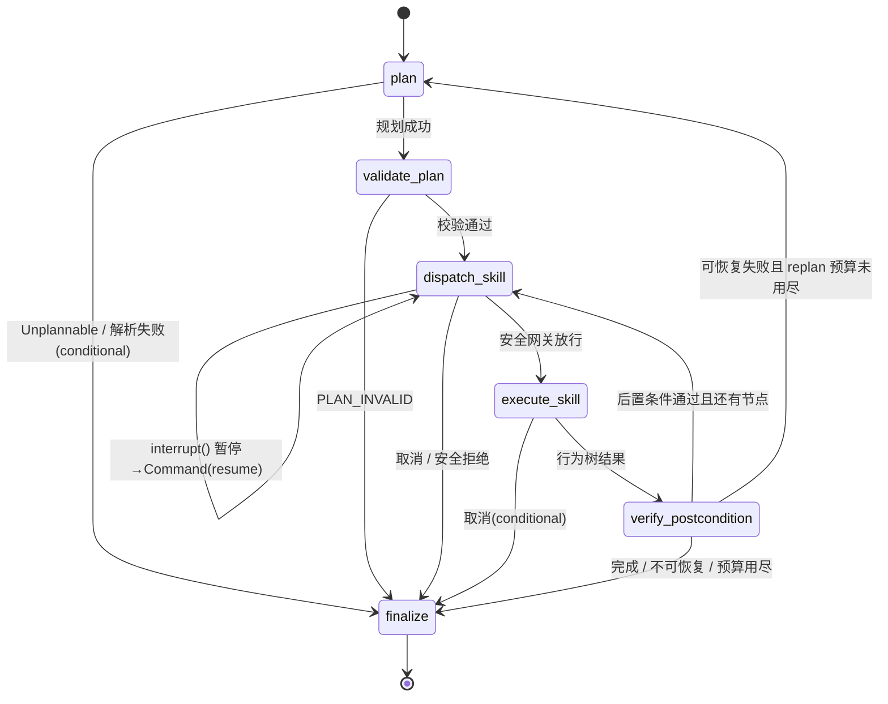

# 架构说明

## 1. 分层与职责

| 层 | 代码 | 职责 | 不负责 |
| --- | --- | --- | --- |
| 交互层 | `api/server.py`, `mcp_server/server.py` | HTTP/SSE 调试台、MCP 工具暴露 | 不做任务规划 |
| 主循环 | `graph/` | 解析指令、生成/校验任务图、调度技能、独立校验后置条件、重规划、暂停/恢复/取消 | 不直接碰机器人 |
| 技能层 | `skills/` | 8 类技能的参数 Schema、前置/后置条件、失败码、取消语义 | 不决定何时调用 |
| 执行层 | `bt/`, `safety/` | 单技能行为树（重试/回退/请求重规划）、四道安全守卫 | 不做跨技能重规划 |
| 后端 | `sim/`, `ros2_bridge/` | 运动学、导航、抓取放置、Action/Service 适配 | 不做安全判断（网关在前） |
| 记忆/观测 | `memory/`, `trace/` | Qdrant 场景/任务/物体记忆、SQLite 会话、JSONL trace | 不参与控制 |

依赖方向自上而下；`sim` 与 `ros2_bridge` 实现同一个 `RobotBackend` 接口，所以技能层、行为树、安全网关、主循环都不需要知道后端是仿真还是 ROS2。

## 2. LangGraph 主循环



* **任务图**：`graph/task_graph.py` 的 `TaskNode`(skill/params/depends_on) DAG；`validate_plan` 做技能存在性、JSON Schema 校验、依赖拓扑（Kahn）、静态排序约束（`pick` 必须在 `approach_object` 之后等）。
* **状态**（`graph/state.py`）全部可 JSON 序列化，LangGraph `SqliteSaver` 按 `thread_id = session_id` 持久化；`world_snapshot` 让 resume 可以重建仿真世界。
* **暂停**：`dispatch_skill` 在技能边界调用 `interrupt({...})`，进程内请求 pause 时也会先清 flag 再 interrupt，避免 resume 后重复中断；恢复用 `Command(resume="resume"|"cancel")`，测试覆盖了「新进程/新 runtime 从 SQLite checkpoint 恢复」。
* **重规划**：失败信息（失败码、技能、尝试次数、已搜索区域）交给 planner；planner 原地 patch 任务图（如换搜索区域、重试导航、重新接近），`TaskPlan.resume_index` 保证已执行前缀不重跑。
* **终态**：`finalize` 记录 trace、写任务记忆、更新 SQLite 会话状态；`goal_verified = status=="finished" && plan_index >= len(plan.nodes)`。

## 3. 行为树（执行层）

```text
Selector("skill_execution")
├── SyncRetry( Sequence(Precondition → Execute → VerifyPostcondition) )   # 瞬时失败重试
├── Sequence(GateRecoverable → Backtrack → Execute → Verify)              # 阻塞类失败先退再试
└── RequestReplan                                                        # 不假装成功：交由主循环 replan
```

* 黑板使用 py_trees 全局 `Blackboard` + 每次执行独立命名空间（`bt_<uuid>`）共享上下文（skill/params/result/report/attempts/events）。
* 每次 run 结束（成功/取消/失败）都 `unset` 全部命名空间键，取消时额外 `backend.cancel_active_goal()`；单测断言黑板无残留键。
* `verify=False` 仅用于消融实验（信任技能返回值），默认始终对世界状态求值。

## 4. 安全网关

所有技能进入后端前都必须 `SafetyGateway.authorize()`；所有速度指令进入底盘前都必须 `filter_velocity()`。守卫顺序：

1. 闩锁急停（`engage_estop` 后所有技能拒绝，只能 `reset_estop(operator_id, code)` 复位）；
2. 技能拒绝名单（`cmd_vel`/`joint_velocity` 等原始驱动技能）；
3. 未注册技能；
4. 参数拒绝名单（嵌套键也会检查，防止绕过技能抽象下发底层控制）；
5. 单技能超时预算上限；
6. 电量阈值（`dock`/`stop`/`speak` 豁免，避免机器人无法自救）；
7. 电子围栏（默认矩形 + 支持自定义多边形），越界 → `OUT_OF_BOUNDS`；
8. 速度类参数裁剪 + `filter_velocity` 限幅。

网关不修改世界状态，拒绝无副作用（有单测）。

## 5. 数据流示例（一次取物）

```text
POST /tasks {"instruction":"把A区的红色盒子拿到工作站台"}
→ plan: parse → TaskPlan[navigate zone_a, find, approach, pick, navigate table, place]
→ validate_plan (schema/DAG/顺序)
→ dispatch: safety.authorize(navigate) → world_before 快照 → trace
→ execute: BT → backend.navigate_to (A* + pure pursuit + 碰撞检测)
→ verify: 世界状态距离 ≤0.5m？→ 通过
→ …(find/approach/pick/place 同理)…
→ finalize: goal_verified=true，写 session + task memory
```

## 6. 观测与回放

* 每个节点/技能/行为树事件都写入 `TraceRecorder`：内存事件 + SQLite `events` 表 + 关闭时 JSONL（`.cache/traces/`，demo 的 trace 已提交到 `demos/traces/`）。
* SSE（`GET /events/{id}`）把 live 事件推给调试台；`scripts/replay_trace.py` 可离线回放，等价于「rosbag + 结构化 trace 复盘失败链路」中的 trace 部分。
